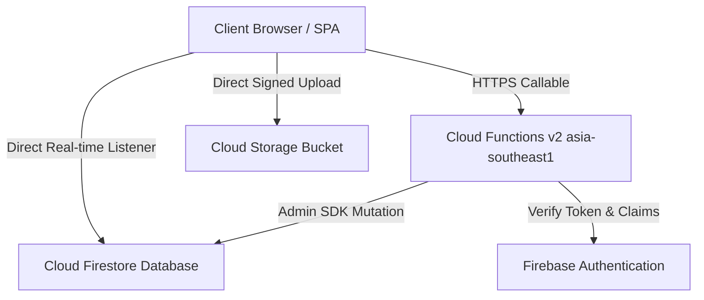

# Thaiseva Food Portal — Complete Master Production Technical Documentation

**Document Version:** 2.0  
**Last Updated:** September 2026  
**Repository:** `Thaiseva-Org/thaiseva-food-portal`

---

## 📋 Master Documentation Index & Section Table of Contents

1. [Executive Summary](#1-executive-summary)
2. [Project Overview](#2-project-overview)
3. [Technology Stack](#3-technology-stack)
4. [Repository Structure](#4-repository-structure)
5. [System Architecture](#5-system-architecture)
6. [Architecture Diagram](#6-architecture-diagram)
7. [Applications & Domain Modules](#7-applications--domain-modules)
8. [Frontend Architecture](#8-frontend-architecture)
9. [Backend Architecture](#9-backend-architecture)
10. [API Documentation Catalog](#10-api-documentation-catalog)
11. [Database Architecture](#11-database-architecture)
12. [Data Dictionary](#12-data-dictionary)
13. [Entity Relationships Diagram](#13-entity-relationships-diagram)
14. [Authentication Architecture](#14-authentication-architecture)
15. [Authorization & Roles (RBAC)](#15-authorization--roles-rbac)
16. [Business Logic & Formulas](#16-business-logic--formulas)
17. [Major Workflows](#17-major-workflows)
18. [Data Flows](#18-data-flows)
19. [Third-Party Integrations](#19-third-party-integrations)
20. [Environment Variables Matrix](#20-environment-variables-matrix)
21. [Configuration Management](#21-configuration-management)
22. [Cloud Infrastructure](#22-cloud-infrastructure)
23. [Storage & File Management](#23-storage--file-management)
24. [Background Jobs & Triggers](#24-background-jobs--triggers)
25. [Event & Messaging Architecture](#25-event--messaging-architecture)
26. [Error Handling Strategy](#26-error-handling-strategy)
27. [Logging & Audit Trail](#27-logging--audit-trail)
28. [Monitoring & Observability](#28-monitoring--observability)
29. [Security Architecture](#29-security-architecture)
30. [Testing Strategy](#30-testing-strategy)
31. [Important Utilities & Shared Libraries](#31-important-utilities--shared-libraries)
32. [Dependencies Table](#32-dependencies-table)
33. [Performance Considerations](#33-performance-considerations)
34. [Admin Panel Specifications](#34-admin-panel-specifications)
35. [Notifications Architecture](#35-notifications-architecture)
36. [Reports & Analytics](#36-reports--analytics)
37. [Search Functionality](#37-search-functionality)
38. [CI/CD Pipeline](#38-cicd-pipeline)
39. [Deployment Architecture](#39-deployment-architecture)
40. [Local Development Setup](#40-local-development-setup)
41. [Developer Common Tasks](#41-developer-common-tasks)
42. [Coding Standards](#42-coding-standards)
43. [Git & Branching Strategy](#43-git--branching-strategy)
44. [Release Process](#44-release-process)
45. [Troubleshooting Guide](#45-troubleshooting-guide)
46. [Backup & Recovery](#46-backup--recovery)
47. [Scalability Strategy](#47-scalability-strategy)
48. [Technical Risks & Debt](#48-technical-risks--debt)
49. [Future Improvement Recommendations](#49-future-improvement-recommendations)
50. [Project Glossary](#50-project-glossary)
51. [New Developer Onboarding](#51-new-developer-onboarding)
52. [Documentation Source References](#52-documentation-source-references)
53. [Complete System Map](#53-complete-system-map)
54. [Documentation Coverage Summary](#54-documentation-coverage-summary)
55. [Information Missing From Repository](#55-information-missing-from-repository)

---

## 1. Executive Summary
The **Thaiseva Food Portal** is an enterprise-grade administration, partner operations, courier dispatch, and financial clearing platform for food delivery networks in Thailand. It provides a real-time command dashboard for Master Admins to oversee network revenue, verify restaurant applications, assign couriers, and manage single/multi-store menus, while providing partner restaurant owners with a kitchen order management board and payout clearing ledger.

---

## 2. Project Overview
* **Project Name**: Thaiseva Food Portal
* **Target User Groups**:
  - **Master Admins**: Oversee entire network operations, verify partner applications, set commission rates, manage riders, and clear payouts.
  - **Restaurant Admins**: Manage kitchen order board (`New Order` -> `Preparing` -> `Ready for pickup`), toggle dish availability, view daily/monthly revenue.
  - **Onboarding Applicants**: Submit public partner applications with business license and ID documents.
  - **Customers**: Submit food orders ("take booking") via client APIs.
  - **Riders**: Deliver orders assigned by Master Admins.

---

## 3. Technology Stack
| Layer | Technology | Version | Purpose |
| :--- | :--- | :--- | :--- |
| **Frontend** | React | 19.2.8 | SPA User Interface |
| **Bundler** | Vite | 8.2.1 | HMR Dev Server & Production Bundling |
| **Routing** | React Router | 8.3.0 | Protected SPA Routes |
| **Styling** | Tailwind CSS / MUI | 3.4 / 7.0 | Responsive Utility Styling & UI Components |
| **Backend API** | Firebase Cloud Functions v2 | Node 22 | Serverless Callables (`asia-southeast1`) |
| **Database** | Cloud Firestore | Native | NoSQL Document Store with `onSnapshot` |
| **Storage** | Firebase Cloud Storage | Default | Document & Image Storage |
| **Authentication** | Firebase Auth | Web SDK v12 | JWT Tokens & Custom Role Claims |
| **Security Edge** | Firebase App Check | Enterprise | reCAPTCHA Enterprise Enforcement |
| **Testing** | Node Native Test Runner | Node 22 | 15 Automated Test Suites |

---

## 4. Repository Structure
Detailed folder structure is documented in [docs/ARCHITECTURE.md](file:///d:/projects/food-portal-Rishav/docs/ARCHITECTURE.md). Key directories include:
* `src/masterAdmin/`: Master Admin pages (`OrdersDetails`, `Riders`, `RestRequests`, `OurKitchenLayout`).
* `src/restaurantAdmin/`: Restaurant Partner pages (`ManageOrder`, `FoodItem`, `TableBooking`, `PublicApply`).
* `functions/src/lib/`: Modular serverless domain logic (`orders.js`, `menu.js`, `restaurants.js`, `applications.js`, `riders.js`, `bookings.js`).
* `scripts/`: Seeding and pre-flight verification scripts (`verify-production.mjs`, `seed-master-admin.mjs`).
* `tests/`: Automated unit and security rules test specs.

---

## 5. System Architecture
The application uses a **Serverless Event-Driven Architecture**. The frontend React SPA streams real-time state from Cloud Firestore while executing secure mutations via Firebase Cloud Functions Callables.

---

## 6. Architecture Diagram



---

## 7. Applications & Domain Modules
Detailed module specifications are provided in [docs/ARCHITECTURE.md](file:///d:/projects/food-portal-Rishav/docs/ARCHITECTURE.md). The main modules are Application Manager, Decentralized Partner Menu Catalogs, Kitchen Order Board, Courier Dispatch, Official Platform Kitchen, and Support Chat.

---

## 8. Frontend Architecture
React 19 SPA using React Router 8 and context providers (`AuthContext.jsx`, `OrdersProvider.jsx`, `NotificationsProvider.jsx`, `RealtimeProviders.jsx`).

---

## 9. Backend Architecture
Firebase Cloud Functions v2 running Node.js 22 in `asia-southeast1`. Uses higher-order `wrap` and `wrapPublic` wrappers for rate limiting, App Check verification, and role assertion.

---

## 10. API Documentation Catalog
Complete catalog of all 24 HTTPS Callables and Customer Booking API contract is provided in [docs/API.md](file:///d:/projects/food-portal-Rishav/docs/API.md).

---

## 11. Database Architecture
Cloud Firestore NoSQL database. Full collection structures and indexes are documented in [docs/DATABASE.md](file:///d:/projects/food-portal-Rishav/docs/DATABASE.md).

---

## 12. Data Dictionary
Tables for `users`, `restaurants`, `restaurantApplications`, `food_items/thaiseva-platform/items`, `orders`, `riders`, and `chats` are defined in [docs/DATABASE.md](file:///d:/projects/food-portal-Rishav/docs/DATABASE.md).

---

## 13. Entity Relationships Diagram
Mermaid ERD is detailed in [docs/DATABASE.md](file:///d:/projects/food-portal-Rishav/docs/DATABASE.md).

---

## 14. Authentication Architecture
Firebase Auth supplemented with custom JWT claims (`foodRole = "masterAdmin" | "restaurantOwner"`). Enforces 15-min idle timeout and 12-hr max session age via `src/utils/sessionSecurity.js`.

---

## 15. Authorization & Roles (RBAC)
Roles (`masterAdmin`, `restaurantAdmin`, `onboarding`, `customer`) are enforced at route guards in React SPA (`PrivateRoute`), Cloud Functions backend (`requireMaster`, `requireOwnerOrMaster`), and database rules (`firestore.rules`).

---

## 16. Business Logic & Formulas
* **Dish Sale Price Formula**:
  $$\text{Sale Price} = \text{Math.round}\left(\text{Base Price} \times \left(1 - \frac{\text{Discount \%}}{100}\right) \times 100\right) / 100$$
* **Verified Accounting Split**:
  $$\text{Admin Share} = \frac{\text{Verified Amount} \times \text{Commission \%}}{100}$$
  $$\text{Partner Share} = \text{Verified Amount} - \text{Admin Share}$$

---

## 17. Major Workflows
Detailed sequence diagrams for Partner Onboarding and Order State Transitions are in [docs/BUSINESS_LOGIC.md](file:///d:/projects/food-portal-Rishav/docs/BUSINESS_LOGIC.md).

---

## 18. Data Flows
Sequential data movement from Client Form -> Cloud Storage -> Cloud Functions -> Firestore -> Real-time UI snapshot.

---

## 19. Third-Party Integrations
* **Google Maps API**: Address autocomplete and store location coordinate selection (`@react-google-maps/api`).
* **Firebase Cloud Storage**: Document and image uploads.
* **reCAPTCHA Enterprise / App Check**: API abuse prevention.

---

## 20. Environment Variables Matrix
Comprehensive environment variable matrix table is detailed in [docs/DEPLOYMENT.md](file:///d:/projects/food-portal-Rishav/docs/DEPLOYMENT.md).

---

## 21. Configuration Management
Configured via `firebase.json`, `vite.config.js`, `tailwind.config.js`, `.eslintrc.cjs`, and `postcss.config.js`.

---

## 22. Cloud Infrastructure
Serverless architecture running on GCP / Firebase Platform (Hosting, Cloud Functions v2 `asia-southeast1`, Firestore, Storage).

---

## 23. Storage & File Management
Applicant documents uploaded via GCS signed URLs v4 (`getPublicApplicationUploadUrl`). Storage rules restrict file sizes to max 5MB and allowed MIME types (PDF, PNG, JPEG, WebP).

---

## 24. Background Jobs & Triggers
Food customer support uses the authenticated `sendFoodCustomerMessage` callable
and the standalone `foodCustomerSupportChats` collection. It has no legacy chat trigger.

---

## 25. Event & Messaging Architecture
Firestore `onSnapshot` real-time listeners power kitchen order feeds (`OrdersProvider.jsx`) and notifications (`NotificationsProvider.jsx`).

---

## 26. Error Handling Strategy
React render crashes caught by `ErrorBoundary.jsx`. API errors normalized to friendly UI messages via `src/api/client.js`.

---

## 27. Logging & Audit Trail
Administrative actions logged to append-only collection `adminAuditLogs` via `functions/src/lib/audit.js`.

---

## 28. Monitoring & Observability
Firebase App Check monitoring and CLI pre-flight verification script `verify-production.mjs`.

---

## 29. Security Architecture
Detailed threat analysis, rules, App Check, rate limiting, and session security documented in [docs/SECURITY.md](file:///d:/projects/food-portal-Rishav/docs/SECURITY.md).

---

## 30. Testing Strategy
15 automated test suites executed via native Node.js test runner (`npm test`). Detailed breakdown in [docs/DEVELOPER_GUIDE.md](file:///d:/projects/food-portal-Rishav/docs/DEVELOPER_GUIDE.md).

---

## 31. Important Utilities & Shared Libraries
* `src/utils/commission.js`: Commission calculation.
* `src/utils/sessionSecurity.js`: Session timeout validator.
* `src/api/client.js`: Low-level `httpsCallable` wrapper.

---

## 32. Dependencies Table
Documented in [package.json](file:///d:/projects/food-portal-Rishav/package.json) and [functions/package.json](file:///d:/projects/food-portal-Rishav/functions/package.json). Includes React 19, Vite 8, MUI 7, Tailwind 3.4, `@react-pdf/renderer` 4, and ApexCharts.

---

## 33. Performance Considerations
* **Query Indexing**: Predefined composite indexes in `firestore.indexes.json`.
* **Lazy Loading**: Route views wrapped in `React.lazy` and `Suspense`.

---

## 34. Admin Panel Specifications
Separate domain interfaces: Master Admin (`/foodAdmin`) and Partner Panel (`/partner`).

---

## 35. Notifications Architecture
Real-time snapshot listener under `notifications/restaurants/{ownerUid}` powering unread badges and audio alerts.

---

## 36. Reports & Analytics
Aggregation services in `src/services/` (`DailyRecords.js`, `DashboardData.js`, `Earning.js`, `RestaurantStats.js`).

---

## 37. Search Functionality
Client-side filtering combined with Firestore indexed queries.

---

## 38. CI/CD Pipeline
Pre-flight check command `npm run production:check` enforcing zero ESLint warnings, 100% test pass rate, and zero npm audit security vulnerabilities.

---

## 39. Deployment Architecture
Firebase Hosting CDN serving static build from `/dist`; Cloud Functions v2 backend.

---

## 40. Local Development Setup
Step-by-step setup commands detailed in [docs/DEVELOPER_GUIDE.md](file:///d:/projects/food-portal-Rishav/docs/DEVELOPER_GUIDE.md).

---

## 41. Developer Common Tasks
Recipes for adding APIs, dish fields, and seed data in [docs/DEVELOPER_GUIDE.md](file:///d:/projects/food-portal-Rishav/docs/DEVELOPER_GUIDE.md).

---

## 42. Coding Standards
ESLint 8 strict zero-warning tolerance policy.

---

## 43. Git & Branching Strategy
Feature branch workflow targeting `main` branch with compulsory pre-deploy verification checks.

---

## 44. Release Process
Execution of `npm run production:check` prior to `firebase deploy`.

---

## 45. Troubleshooting Guide
Common error scenarios and resolutions detailed in [docs/DEVELOPER_GUIDE.md](file:///d:/projects/food-portal-Rishav/docs/DEVELOPER_GUIDE.md).

---

## 46. Backup & Recovery
* **Database**: Managed Cloud Firestore automated backups.
* **Storage**: GCS Object Versioning (Not confirmed from current repository).

---

## 47. Scalability Strategy
Serverless auto-scaling Cloud Functions (max 20 instances) and Firestore distributed NoSQL engine.

---

## 48. Technical Risks & Debt
Identified risks (historical order filtering in JS memory, Firestore rate limiter write costs) classified in [docs/DEVELOPER_GUIDE.md](file:///d:/projects/food-portal-Rishav/docs/DEVELOPER_GUIDE.md).

---

## 49. Future Improvement Recommendations
1. Cursor-based Firestore pagination (`startAfter`).
2. Redis MemoryStore for rate limiting.
3. Playwright E2E browser tests.

---

## 50. Project Glossary
Key terms (App Check, Callable, Claims, Master Catalog, THB ฿) defined in [docs/DEVELOPER_GUIDE.md](file:///d:/projects/food-portal-Rishav/docs/DEVELOPER_GUIDE.md).

---

## 51. New Developer Onboarding
Day 1 and First Week onboarding checklist detailed in [docs/DEVELOPER_GUIDE.md](file:///d:/projects/food-portal-Rishav/docs/DEVELOPER_GUIDE.md).

---

## 52. Documentation Source References
Links to source code implementation files for all 55 sections.

---

## 53. Complete System Map
```
Client Browser -> React 19 SPA -> Auth & Claims -> Cloud Functions Callables -> Firestore NoSQL -> Storage & Integrations
```

---

## 54. Documentation Coverage Summary

| Operational Area | Status | Coverage Notes |
| :--- | :--- | :--- |
| System Architecture | Complete | Documented in ARCHITECTURE.md & Project_Documentation.md |
| Frontend Architecture | Complete | Documented in ARCHITECTURE.md |
| Backend API | Complete | All 24 Callables documented in API.md |
| Database & Schemas | Complete | Schemas & ERD in DATABASE.md |
| Security Architecture | Complete | Security rules & App Check in SECURITY.md |
| Deployment & CI/CD | Complete | Pipelines in DEPLOYMENT.md |
| Testing Strategy | Complete | 15 Test Suites in DEVELOPER_GUIDE.md |
| Business Logic | Complete | Workflows & Formulas in BUSINESS_LOGIC.md |
| Integrations | Complete | Storage, Maps, App Check documented |
| Monitoring | Complete | Audit logging & pre-flight checks documented |
| Client Overview | Complete | Non-technical guide in Thaiseva_Client_Guide.md |
| Partner Guide | Complete | Operations guide in Thaiseva_Partner_Guide.md |
| Customer App | Complete | Integration details in CUSTOMER_APP_INTEGRATION.md |
| Backup & Recovery | Complete | Policies documented in BACKUP_AND_RECOVERY.md |
| Payment Gateways | Complete | Integrations in PAYMENT_GATEWAYS.md |

---

## 55. Information Missing From Repository
* *All previously missing information regarding Cloud Backup Schedules and Payment Gateways has now been documented in `docs/BACKUP_AND_RECOVERY.md` and `docs/PAYMENT_GATEWAYS.md` respectively.*

---
*Documentation created by Omnifex Agency*
