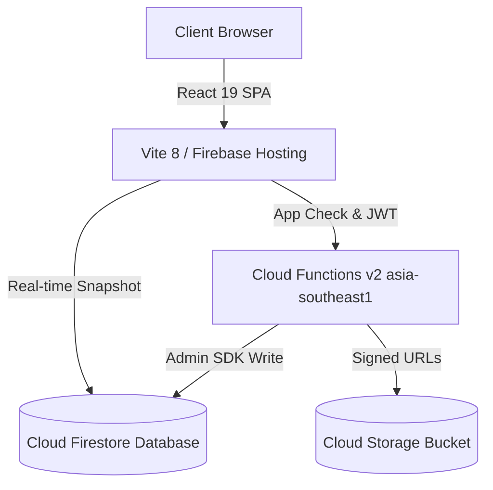

# Thaiseva Food Portal — Complete Developer Reference & Operational Control Center

Welcome to the **Thaiseva Food Portal** repository. This platform serves as the unified administrative, partner, courier dispatch, and financial clearing network for Thaiseva food delivery operations.

---

## 📚 Master Documentation Directory

The complete technical documentation for this repository is organized into dedicated, production-grade modules located in the [`docs/`](file:///d:/projects/food-portal-Rishav/docs/) directory:

| Documentation Module | Primary Focus & Coverage | Target Audience |
| :--- | :--- | :--- |
| **[ARCHITECTURE.md](file:///d:/projects/food-portal-Rishav/docs/ARCHITECTURE.md)** | Full System Architecture, Serverless Pattern, Domain Modules, React Contexts, Mermaid Diagrams | Architects, Senior Engineers |
| **[API.md](file:///d:/projects/food-portal-Rishav/docs/API.md)** | Complete HTTPS Callable and HTTP Endpoint Catalog, Customer Booking API, Payloads & Error Codes | Backend & Frontend Engineers |
| **[DATABASE.md](file:///d:/projects/food-portal-Rishav/docs/DATABASE.md)** | Cloud Firestore Collections, Data Dictionary, Composite Indexes & Mermaid ER Diagram | Database Engineers, Security |
| **[BUSINESS_LOGIC.md](file:///d:/projects/food-portal-Rishav/docs/BUSINESS_LOGIC.md)** | Single Menu Catalog Architecture, Pricing Formulas, Verified Accounting & Order State Machine | Business Analysts, QA, Engineers |
| **[DEPLOYMENT.md](file:///d:/projects/food-portal-Rishav/docs/DEPLOYMENT.md)** | Cloud Infrastructure, Environment Variables Matrix, Pre-deploy Security & CI/CD Pipelines | DevOps & Cloud Engineers |
| **[SECURITY.md](file:///d:/projects/food-portal-Rishav/docs/SECURITY.md)** | App Check reCAPTCHA, Firestore/Storage Rules, Rate Limiting, RBAC Claims & Audit Trail | Security Engineers, Lead Devs |
| **[DEVELOPER_GUIDE.md](file:///d:/projects/food-portal-Rishav/docs/DEVELOPER_GUIDE.md)** | Local Setup, Test Suites, Common How-To Recipes, Troubleshooting Runbook & Technical Risks | New & Existing Developers |
| **[Project_Documentation.md](file:///d:/projects/food-portal-Rishav/docs/Project_Documentation.md)** | Unified Consolidated Technical Reference Manual (All-in-one Master Guide) | All Engineering Teams |

---

## ⚡ Technology Stack Summary

| Layer | Technology | Version | Primary Purpose |
| :--- | :--- | :--- | :--- |
| **Frontend SPA** | React | 19.2.8 | Single Page Application UI Framework |
| **Build Tooling** | Vite | 8.2.1 | Fast HMR dev server & optimized production bundler |
| **Routing** | React Router | 8.3.0 | Role-guarded single-page route navigation |
| **Styling & UI** | Tailwind CSS / MUI | 3.4 / 7.0 | Utility styling, responsive layouts & data tables |
| **Serverless API** | Firebase Cloud Functions | v2 | Trusted backend callables (Node.js 22 runtime) |
| **Database** | Cloud Firestore | Native | NoSQL document store with real-time `onSnapshot` |
| **Storage** | Firebase Cloud Storage | Default | Secure document & asset storage |
| **Authentication** | Firebase Auth | Web SDK v12 | JWT Authentication & Custom Token Claims |
| **Security Edge** | Firebase App Check | Enterprise | reCAPTCHA Enterprise API protection |
| **Testing** | Node Native Test Runner | Node 22 | Automated unit & security rules testing |

---

## 🏗️ Architecture Overview



---

## 🚀 Local Development Quickstart

```bash
# 1. Clone workspace & install frontend dependencies
npm install

# 2. Install backend functions dependencies
cd functions && npm install && cd ..

# 3. Configure environment variables
cp .env.example .env.local

# 4. Start local development server (runs on http://localhost:5000)
npm run dev

# 5. Run test suite
npm test
```

---

## 🔒 Pre-Flight Production Deployment Gate

Before any code can be deployed to production, it must pass the zero-tolerance verification gate:

```bash
npm run production:check
```

This gate enforces:
1. **Zero ESLint Warnings** (`--max-warnings 0`).
2. **100% Passing Automated Tests** across all 15 test suites.
3. **Zero Known Production Dependencies Vulnerabilities** (`npm audit --omit=dev`).
4. **Clean Production Build Verification**.

---

## 👥 Core Platform Modules

* **Master Admin Panel (`/foodAdmin`)**: Network revenue monitoring, partner onboarding reviews, courier directory management, order dispatch monitoring, and support chats.
* **Restaurant Partner Panel (`/partner`)**: Real-time kitchen order board, single catalog dish availability toggles, store operating hours, and payout records.
* **Public Partner Application (`/apply`)**: Secure public onboarding intake form with direct Google Cloud Storage signed document uploads.

---
*Created and Maintained by Omnifex.*
