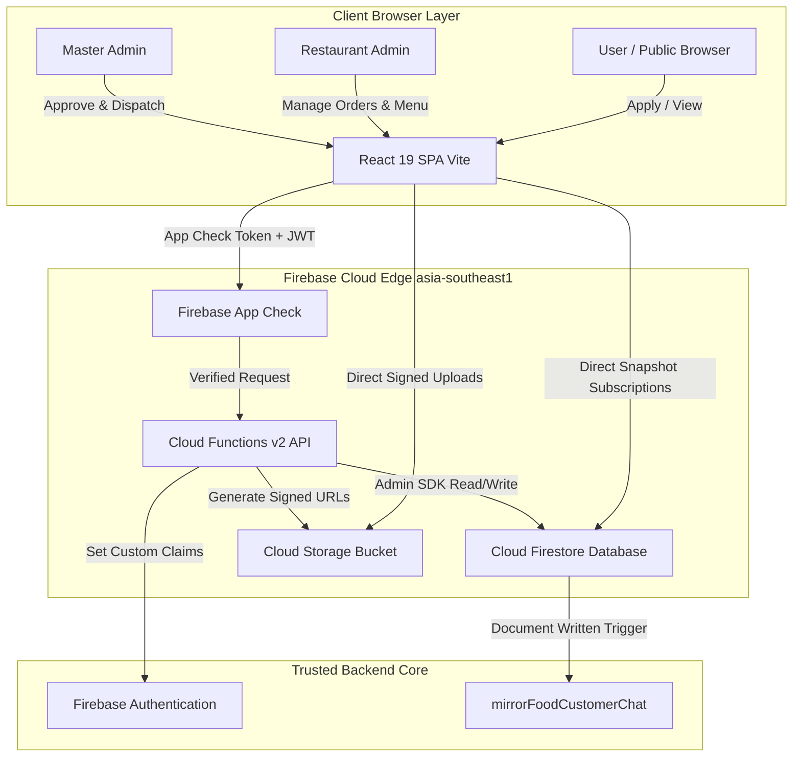

# System Architecture Documentation — Thaiseva Food Portal

## 1. System Overview & Architectural Pattern

The **Thaiseva Food Portal** is an enterprise-grade food ordering, restaurant onboarding, courier dispatch, and financial clearing platform. It uses a **Serverless Event-Driven Modular Architecture** paired with a single-page frontend application (SPA).

### Key Architectural Characteristics
* **Frontend Layer**: Single Page Application (SPA) built with **React 19** and bundled via **Vite 8**. It implements strict role-based routing guarded by custom authentication context providers.
* **Backend API Layer**: Trusted serverless backend running on **Firebase Cloud Functions v2** (Node.js 22 runtime, deployed to `asia-southeast1`). All mutated operations use HTTPS Callable Functions (`onCall`) wrapped with rate limiting and App Check verification.
* **Data Layer**: **Cloud Firestore** NoSQL document store. Firestore provides real-time `onSnapshot` streaming capabilities directly to the React application while maintaining tenant-isolated database security rules.
* **Storage Layer**: **Firebase Cloud Storage** for private partner verification documents (PDF/Image) and public assets (restaurant covers, dish photos).
* **Identity & Security Layer**: **Firebase Authentication** supplemented with Firebase Custom Claims for Role-Based Access Control (RBAC) and **Firebase App Check** (reCAPTCHA Enterprise) to protect against API abuse.

---

## 2. High-Level Architecture Diagram



---

## 3. Complete Repository Structure & Directory Map

```
thaiseva-food-portal/
├── .env.example                       # Template for client environment variables
├── .env.local                         # Local environment overrides
├── .env.production.local              # Production environment overrides
├── .eslintrc.cjs                      # Strict ESLint 8 configuration (0-warning rule)
├── firebase.json                      # Firebase Hosting, Functions, Rules configuration
├── firebaseConfig.js                  # Firebase Web SDK v12 initialization & App Check
├── firestore.indexes.json             # Production Firestore composite index definitions
├── firestore.rules                   # Multi-tenant security rules policy
├── storage.rules                     # Cloud Storage file upload & read security rules
├── package.json                       # Frontend dependencies, scripts & build pipelines
├── postcss.config.js                  # PostCSS Tailwind preprocessor config
├── tailwind.config.js                 # Tailwind CSS 3.4 theme definitions
├── vite.config.js                     # Vite dev server & production bundling config
│
├── docs/                              # Project Technical Documentation Modules
│   ├── ARCHITECTURE.md                # System Architecture & Diagrams (This Document)
│   ├── API.md                         # HTTPS Callable API Reference & Specs
│   ├── DATABASE.md                    # Database Schemas, Data Dictionary & ERD
│   ├── BUSINESS_LOGIC.md             # Menu Catalog, Workflows & State Machines
│   ├── DEPLOYMENT.md                  # Infrastructure, CI/CD & Environment Variables
│   ├── SECURITY.md                    # App Check, Rules, Rate Limiting & RBAC
│   ├── DEVELOPER_GUIDE.md             # Local Setup, Testing, Tasks & Troubleshooting
│   └── Project_Documentation.md       # Master Consolidated Technical Manual
│
├── functions/                         # Cloud Functions Backend Package
│   ├── package.json                   # Backend Node 22 dependencies & scripts
│   └── src/
│       ├── index.js                   # Entry point exporting 24 HTTPS callables & 1 trigger
│       └── lib/                       # Domain Isolated Service Controllers
│           ├── applications.js        # Public & partner onboarding application processing
│           ├── audit.js               # Administrative audit trail logger
│           ├── auth.js                # Auth claims verification & tenant assertions
│           ├── bookings.js            # Table reservation & dine-in booking handlers
│           ├── customerChats.js       # Real-time customer chat sync handlers
│           ├── menu.js                # Single catalog menu mutations & store overrides
│           ├── orderPayments.js       # Payment clearing & accounting verification
│           ├── orders.js              # Order state machine & verified accounting
│           ├── restaurants.js         # Restaurant profiles & open/close state logic
│           └── riders.js              # Courier directory & assignment operations
│
├── scripts/                           # Developer Operational & Seeding Scripts
│   ├── check-items.mjs                # Menu item integrity checker
│   ├── cleanup.mjs                    # Test data cleanup script
│   ├── delete-auth-user.mjs           # Utility to remove test auth accounts
│   ├── fix-seed.mjs                   # Seed data repair script
│   ├── merge-live-rules.mjs           # Security rules consolidation tool
│   ├── migrate-restaurant-menus.mjs   # Legacy store menu to single catalog migrator
│   ├── migrate-support-chats.mjs      # Customer chat format migrator
│   ├── rename-auth-email.mjs          # Auth user email update script
│   ├── reset-demo-stats.mjs           # Resets demo partner stats
│   ├── seed-demo-restaurant.mjs       # Seeds demo restaurant account & menu
│   ├── seed-demo-riders.mjs           # Seeds demo courier accounts
│   ├── seed-master-admin.mjs          # Provisions Master Admin user and custom claims
│   ├── seed-orders-admin.mjs          # Seeds demo kitchen orders
│   └── verify-production.mjs          # Pre-flight production environment validator
│
├── src/                               # Frontend Source Code
│   ├── App.jsx                        # Main React Router 8 router tree & route definitions
│   ├── AuthContext.jsx                # Authentication provider, session timer & claims resolver
│   ├── index.css                      # Global Tailwind CSS & component styles
│   ├── main.jsx                       # React 19 root DOM entry point
│   ├── api/                           # Client API Layer
│   │   ├── client.js                  # Axios/Callable request wrapper with error normalization
│   │   └── index.js                   # Unified export of client API caller functions
│   ├── components/                    # Reusable UI Components
│   │   ├── ErrorBoundary.jsx          # React error boundary catching render crashes
│   │   ├── Loading.jsx                # Global loading spinner component
│   │   ├── chat/                      # Support chat UI components
│   │   ├── dashboard/                 # Data summary cards & analytical charts
│   │   └── ui/                        # Reusable modals, badges, form controls
│   ├── context/                       # React Real-time Context Providers
│   │   ├── NotificationsProvider.jsx  # Notification stream provider
│   │   ├── OrdersProvider.jsx         # Kitchen orders real-time stream provider
│   │   └── RealtimeProviders.jsx      # Lazy-loaded wrapper combining real-time providers
│   ├── masterAdmin/                   # Master Admin Domain Panel
│   │   ├── component/                 # Admin navigation, headers & stat widgets
│   │   └── pages/                     # Master Admin Views (Orders, Riders, Invoices, Platform)
│   ├── restaurantAdmin/               # Restaurant Partner Domain Panel
│   │   ├── component/                 # Partner navigation & legacy route guards
│   │   └── pages/                     # Partner Views (Kitchen Order Board, Menu, Profile)
│   ├── services/                      # Client Business Logic & Firestore Query Layer
│   │   ├── DailyRecords.js            # Payout records & financial clearing queries
│   │   ├── DashboardData.js           # Network-wide & single-store KPI query service
│   │   ├── Earning.js                 # Revenue & earnings breakdown queries
│   │   ├── GetOrders.js               # Filtered order list query service
│   │   ├── RestaurantStats.js         # Partner performance metrics service
│   │   └── RiderOrders.js             # Courier job summary query service
│   └── utils/                         # Helper Functions & Business Formulas
│       ├── adminIdentity.js           # Admin email & claim matcher
│       ├── applicationFiles.js        # GCS signed URL helper
│       ├── authRouting.js             # Onboarding step resolver
│       ├── authSession.js             # Sign-out & session clearance helper
│       ├── commission.js              # Verified financial commission calculation
│       ├── partnerRoutes.js           # Route path constants (`/partner`)
│       └── sessionSecurity.js         # Client session timeout & activity tracking
│
└── tests/                             # Automated Test Suite (15 Test Specs)
    ├── backendValidation.test.cjs     # Payload validation and sanitization tests
    ├── commission.test.js             # Financial commission calculation tests
    ├── createFoodOrder.test.cjs       # Order creation payload tests
    ├── customerChats.test.cjs         # Support chat routing tests
    ├── dineInBookings.test.cjs        # Table reservation status tests
    ├── firestoreIndexesIsolation.test.cjs # Index protection tests
    ├── firestoreRulesIsolation.test.cjs # Firestore security rules isolation tests
    ├── onboardingPhase.test.js        # Onboarding step resolver tests
    ├── orderData.test.js              # Order data model integrity tests
    ├── orderFetching.test.js          # Firestore query filtering tests
    ├── orderPayments.test.cjs         # Financial clearing status tests
    ├── orderRider.test.js             # Courier assignment logic tests
    ├── partnerRoutes.test.js          # Protected route guard tests
    ├── restaurantMenuFlow.test.cjs    # Single menu catalog mutation tests
    └── sessionSecurity.test.js        # Session idle & max age timeout tests
```

---

## 4. Application Components & Domain Modules

The application is structured into seven primary functional domain modules:

### 4.1 Onboarding & Application Manager
* **Purpose**: Manages partner onboarding from public application to verification.
* **Relevant Files**:
  - Frontend: [PublicApply.jsx](file:///d:/projects/food-portal-Rishav/src/restaurantAdmin/pages/onboarding/PublicApply.jsx), [OwnerOnboarding.jsx](file:///d:/projects/food-portal-Rishav/src/restaurantAdmin/pages/onboarding/OwnerOnboarding.jsx), [RestRequests.jsx](file:///d:/projects/food-portal-Rishav/src/masterAdmin/pages/RestRequests.jsx)
  - Backend: [applications.js](file:///d:/projects/food-portal-Rishav/functions/src/lib/applications.js), [restaurants.js](file:///d:/projects/food-portal-Rishav/functions/src/lib/restaurants.js)
* **Processing**: Public applicants upload business licenses and owner IDs via GCS signed URLs. Master Admins review requests in `RestRequests.jsx` and call `reviewRestaurantApplication`. Verification automatically provisions a Firebase Auth account, copies uploaded files to production storage paths, sets custom claims, and creates the partner document.

### 4.2 Single Centralized Menu Catalog
* **Purpose**: Controls dish definitions, store assignments, and availability overrides.
* **Relevant Files**:
  - Frontend: [FoodItem.jsx](file:///d:/projects/food-portal-Rishav/src/restaurantAdmin/pages/FoodItem.jsx), [AddItem.jsx](file:///d:/projects/food-portal-Rishav/src/restaurantAdmin/pages/itemPages/AddItem.jsx), [EditFoodItem.jsx](file:///d:/projects/food-portal-Rishav/src/restaurantAdmin/pages/itemPages/EditFoodItem.jsx)
  - Backend: [menu.js](file:///d:/projects/food-portal-Rishav/functions/src/lib/menu.js)
* **Processing**: Dishes are stored under `food_items/thaiseva-platform/items`. Master Admins create/update global dish parameters. Partner restaurants enable/disable availability for their store via `restaurantStatus[ownerUid].active`.

### 4.3 Kitchen Order Board & State Machine
* **Purpose**: Real-time kitchen ticket handling and state machine progression.
* **Relevant Files**:
  - Frontend: [ManageOrder.jsx](file:///d:/projects/food-portal-Rishav/src/restaurantAdmin/pages/ManageOrder.jsx), [OrdersProvider.jsx](file:///d:/projects/food-portal-Rishav/src/context/OrdersProvider.jsx)
  - Backend: [orders.js](file:///d:/projects/food-portal-Rishav/functions/src/lib/orders.js)
* **Processing**: Real-time Firestore snapshot listeners stream incoming orders. Partner admins accept orders, updating status from `New Order` to `Preparing` and `Ready for pickup`.

### 4.4 Courier Dispatch & Rider Directory
* **Purpose**: Manages delivery courier profiles, active statuses, and order assignments.
* **Relevant Files**:
  - Frontend: [Riders.jsx](file:///d:/projects/food-portal-Rishav/src/masterAdmin/pages/Riders.jsx), [RiderOverview.jsx](file:///d:/projects/food-portal-Rishav/src/masterAdmin/pages/RiderOverview.jsx)
  - Backend: [riders.js](file:///d:/projects/food-portal-Rishav/functions/src/lib/riders.js)
* **Processing**: Master Admins add/edit riders. When an order reaches `Ready for pickup`, Master Admins assign an active courier using `assignOrderRider`. Upon delivery, calling `markOrderDelivered` triggers an atomic transaction calculating revenue share.

### 4.5 Official Platform Kitchen ("Our Kitchen")
* **Purpose**: Operates the primary brand kitchen ("Thaiseva Official Kitchen") for direct ordering.
* **Relevant Files**:
  - Frontend: [OurKitchenLayout.jsx](file:///d:/projects/food-portal-Rishav/src/masterAdmin/pages/platform/OurKitchenLayout.jsx), [OurKitchenOrders.jsx](file:///d:/projects/food-portal-Rishav/src/masterAdmin/pages/platform/OurKitchenOrders.jsx)
  - Backend: `ensurePlatformRestaurant` in [restaurants.js](file:///d:/projects/food-portal-Rishav/functions/src/lib/restaurants.js)

### 4.6 Table Reservation & Dine-In Booking Engine
* **Purpose**: Manages table reservation requests submitted by customers.
* **Relevant Files**:
  - Frontend: [TableBooking.jsx](file:///d:/projects/food-portal-Rishav/src/restaurantAdmin/pages/TableBooking.jsx)
  - Backend: [bookings.js](file:///d:/projects/food-portal-Rishav/functions/src/lib/bookings.js)

### 4.7 Support Chat & Messaging
* **Purpose**: Real-time communication between customers, restaurant partners, and master admins.
* **Relevant Files**:
  - Frontend: [CustomerChat.jsx](file:///d:/projects/food-portal-Rishav/src/masterAdmin/pages/CustomerChat.jsx), [RestaurantChat.jsx](file:///d:/projects/food-portal-Rishav/src/restaurantAdmin/pages/RestaurantChat.jsx)
  - Backend: [customerChats.js](file:///d:/projects/food-portal-Rishav/functions/src/lib/customerChats.js)

---

## 5. Frontend Architecture & State Management

### 5.1 Context Architecture
The React SPA relies on specialized providers:
1. **`AuthContext.jsx`**: Centralized authentication state. Manages Firebase Auth state, fetches custom token claims, reads role documents, calculates session idle time, and handles force logouts.
2. **`OrdersProvider.jsx`**: Manages real-time Firestore `onSnapshot` subscriptions to incoming orders for the active partner or master admin. Plays audio alert sounds upon receiving new kitchen tickets.
3. **`NotificationsProvider.jsx`**: Listens for system notifications and maintains unread alert counters.
4. **`RealtimeProviders.jsx`**: Lazy-loaded wrapper combining `OrdersProvider` and `NotificationsProvider` for authenticated admin sessions.

### 5.2 Component Hierarchy & Lazy Loading
Routing is managed by `React Router 8`. All major route views are wrapped in `React.lazy` and `Suspense` fallbacks to ensure minimal initial bundle sizes:

```
[ App.jsx ]
 ├── AuthProvider
 └── BrowserRouter
      └── Suspense (Loading Spinner)
           ├── Public Routes (/auth, /apply, /)
           ├── Protected Onboarding Routes (/onboarding) -> PrivateRoute (role: onboarding)
           ├── Protected Partner Routes (/partner/*) -> PrivateRoute (role: restaurantAdmin)
           │    └── RealtimeProviders
           │         └── ResturantAdminHome (Layout)
           │              ├── Stat
           │              ├── ManageOrder
           │              ├── FoodItem
           │              └── Restaurant Profile
           └── Protected Master Admin Routes (/foodAdmin/*) -> PrivateRoute (role: masterAdmin)
                └── RealtimeProviders
                     └── MasterHome (Layout)
                          ├── MasterStat
                          ├── RestRequests
                          ├── Riders
                          ├── OrdersDetails
                          └── Platform Kitchen
```

---

## 6. Backend Architecture & Cloud Functions Wrapper Pattern

### 6.1 Serverless Execution Pipeline
All backend functions run on Node.js 22 in `asia-southeast1`. Functions are wrapped in standard higher-order wrappers defined in [functions/src/index.js](file:///d:/projects/food-portal-Rishav/functions/src/index.js):

#### Authenticated Wrapper (`wrap`)
```js
function wrap(handler, { roles } = {}) {
  const enforceAppCheck = process.env.FUNCTIONS_EMULATOR !== "true" && process.env.ENFORCE_APP_CHECK !== "false";
  return onCall({ cors: true, enforceAppCheck }, async (request) => {
    try {
      const caller = await resolveCaller(request);
      await enforceRateLimit(caller, request.rawRequest?.path || "callable");
      if (roles?.includes("masterAdmin")) requireMaster(caller);
      const data = await handler(caller, request.data || {});
      return { ok: true, data };
    } catch (err) {
      if (err instanceof HttpsError) throw err;
      throw new HttpsError("internal", "Internal error");
    }
  });
}
```

#### Public Unauthenticated Wrapper (`wrapPublic`)
```js
function wrapPublic(handler, maxRequests = 20) {
  return onCall({ cors: true, enforceAppCheck: false, invoker: "public" }, async (request) => {
    const ip = String(request.rawRequest?.ip || "anon").split(",")[0].trim();
    await enforceRateLimit({ uid: `anon_${ip}` }, "public-apply", maxRequests);
    const data = await handler(request.data || {});
    return { ok: true, data };
  });
}
```

---

## 7. Documentation Source References

* Main Application Router: [src/App.jsx](file:///d:/projects/food-portal-Rishav/src/App.jsx)
* Auth State & Claims: [src/AuthContext.jsx](file:///d:/projects/food-portal-Rishav/src/AuthContext.jsx)
* Backend Function Exports: [functions/src/index.js](file:///d:/projects/food-portal-Rishav/functions/src/index.js)
* Auth & Rate Limit Core: [functions/src/lib/auth.js](file:///d:/projects/food-portal-Rishav/functions/src/lib/auth.js)


---
*Documentation created by Omnifex Agency*
