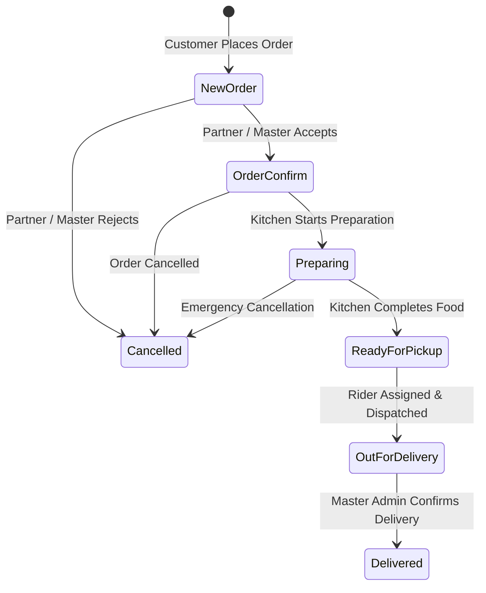
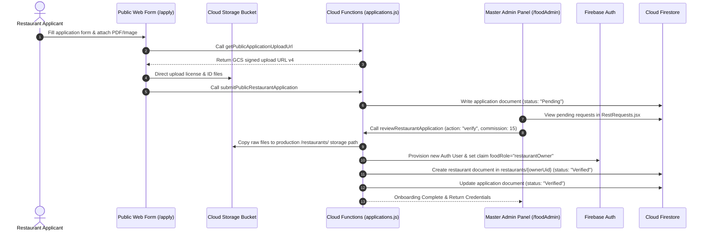

# Business Logic & Workflow Specifications — Thaiseva Food Portal

## 1. Single Centralized Menu Catalog Architecture

The platform uses a **Single Centralized Master Catalog** model. All dishes across all restaurant partners are maintained in a single master collection in Cloud Firestore:

$$\text{Collection Path: } \texttt{food\_items/thaiseva-platform/items/\{itemId\}}$$

```
+-----------------------------------------------------------------------------------+
|                        Cloud Firestore Master Catalog                             |
|                 food_items/thaiseva-platform/items/{itemId}                       |
+-----------------------------------------------------------------------------------+
                                          |
          +-------------------------------+-------------------------------+
          |                                                               |
          v                                                               v
+-----------------------------------+                           +-----------------------------------+
| Assigned to Restaurant A          |                           | Assigned to Restaurant B          |
| assignedRestaurants: ["owner_A"]  |                           | assignedRestaurants: ["owner_B"]  |
| restaurantStatus.owner_A: active  |                           | restaurantStatus.owner_B: hidden  |
+-----------------------------------+                           +-----------------------------------+
```

### Key Architectural Rules
1. **Single Source of Truth**: Dishes exist exactly once under `food_items/thaiseva-platform/items`. Partner restaurants do not create isolated dish tables.
2. **Master Control**: Master Admins manage base dish parameters (title, category, type, image, base price, discount, global active state `active`) and store assignments (`assignedRestaurants`).
3. **Store-Level Availability**: Partner restaurants toggle local availability using `restaurantStatus[ownerUid].active`.
4. **Data Isolation**: A partner restaurant can only view and toggle dishes that include their `ownerUid` in `assignedRestaurants`.

---

## 2. Pricing, Discount & Verified Accounting Formulas

### 2.1 Dish Sale Price Calculation
The sale price of a dish after applying discount percentage is calculated as follows:

$$\text{Sale Price} = \frac{\text{Math.round}\left(\text{Base Price} \times \left(1 - \frac{\text{Discount \%}}{100}\right) \times 100\right)}{100}$$

### 2.2 Order Subtotal & Verified Total
When an order is submitted, the `createFoodOrderHttp` endpoint and its internal accounting service re-query dish unit prices to verify totals inside an atomic transaction. Client-submitted prices are strictly ignored for financial ledger calculations.

$$\text{Subtotal} = \sum_{i=1}^{N} \left( \text{Verified Sale Price}_i \times \text{Quantity}_i \right)$$

$$\text{Verified Order Total} = \text{Subtotal} + \text{Delivery Fee}$$

### 2.3 Financial Payout & Commission Split
When an order is marked as `Delivered` via `markOrderDelivered`, the platform calculates revenue shares based on the stamped commission percentage:

$$\text{Admin Commission Share} = \frac{\text{Verified Order Total} \times \text{Commission \%}}{100}$$

$$\text{Partner Revenue Share} = \text{Verified Order Total} - \text{Admin Commission Share}$$

---

## 3. Order Lifecycle & Workflow State Machine

Food orders transition through a strictly governed state machine:



### 3.1 State Transition Matrix

| Current State | Target State | Triggering Function | Allowed Roles | System Requirements & Side Effects |
| :--- | :--- | :--- | :--- | :--- |
| `[None]` | `New Order` | `createFoodOrderHttp` | Customer / User | Validates items in catalog; writes order document; sets `isPaymentClear = false`. |
| `New Order` | `Order Confirm` | `transitionOrderStatus` | Partner / Master | Confirms order acceptance; notifies customer. |
| `New Order` | `Cancelled` | `transitionOrderStatus` | Partner / Master | Rejects order; marks terminal state. |
| `Order Confirm` | `Preparing` | `transitionOrderStatus` | Partner / Master | Advances kitchen ticket display. |
| `Preparing` | `Ready for pickup` | `transitionOrderStatus` | Partner / Master | Signals dispatch interface that order is ready for courier assignment. |
| `Ready for pickup` | `Out for Delivery` | `transitionOrderStatus` | Partner / Master | **Pre-condition**: Must have an assigned `riderId` (`DeliveryPartner` snapshot attached). |
| `Out for Delivery` | `Delivered` | `markOrderDelivered` | Master Admin | **Atomic Transaction**: Sets status to `Delivered`; calculates admin & partner shares; increments restaurant order count & lifetime earnings; increments item sell counts. |
| Any State | `Cancelled` | `transitionOrderStatus` | Partner / Master | Cancels order. Terminal state. |

---

## 4. End-to-End Partner Onboarding Workflow



---

## 5. Table Reservation & Dine-In Booking Workflow

1. **Submission**: Customers submit table reservation requests via `createDineInBooking`. The system validates `guestCount` (`1` to `20`), validates date format (`YYYY-MM-DD`), and enforces rate limits (max 10 bookings per user per minute).
2. **Pending Queue**: The reservation document is created in `dineInBookings/{bookingId}` with `status = "Pending"`.
3. **Partner Review**: The target restaurant views incoming table reservations in [TableBooking.jsx](file:///d:/projects/food-portal-Rishav/src/restaurantAdmin/pages/TableBooking.jsx).
4. **Confirmation / Rejection**: Partner calls `setDineInBookingStatus` with `status: "Confirmed"` or `status: "Rejected"`.
5. **Customer Cancellation**: Customers can cancel pending bookings using `cancelDineInBooking`.

---

## 6. Documentation Source References

* Menu Catalog Backend: [functions/src/lib/menu.js](file:///d:/projects/food-portal-Rishav/functions/src/lib/menu.js)
* Order State Machine: [functions/src/lib/orders.js](file:///d:/projects/food-portal-Rishav/functions/src/lib/orders.js)
* Onboarding Application Logic: [functions/src/lib/applications.js](file:///d:/projects/food-portal-Rishav/functions/src/lib/applications.js)
* Commission Calculation Helper: [src/utils/commission.js](file:///d:/projects/food-portal-Rishav/src/utils/commission.js)
* State Machine Test Specs: [tests/restaurantMenuFlow.test.cjs](file:///d:/projects/food-portal-Rishav/tests/restaurantMenuFlow.test.cjs)


---
*Documentation created by Omnifex Agency*
