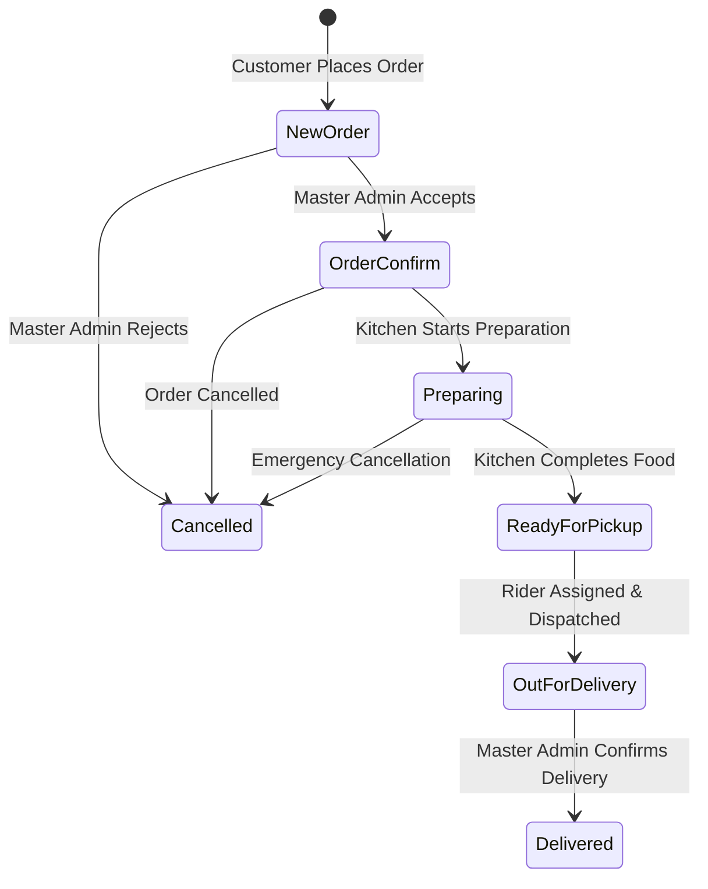
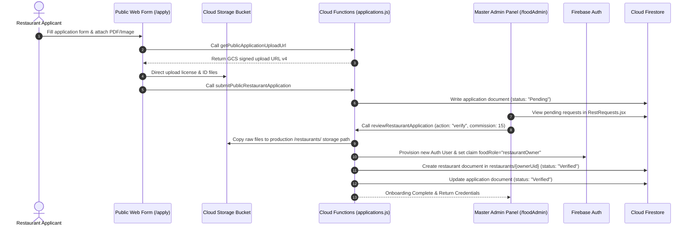

# Business Logic & Workflow Specifications — Thaiseva Food Portal

## 1. Decentralized Partner Menu Architecture

The platform uses a **Decentralized Partner Menu** model. Each partner restaurant independently creates and manages their own distinct catalog of dishes.

$$\text{Collection Path: } \texttt{food\_items/\{ownerUid\}/items/\{itemId\}}$$
(or similar per-restaurant isolation path)

```
+-----------------------------------+                           +-----------------------------------+
|          Restaurant A Menu        |                           |          Restaurant B Menu        |
| food_items/owner_A/items/{itemId} |                           | food_items/owner_B/items/{itemId} |
+-----------------------------------+                           +-----------------------------------+
| - Pad Thai (Price: 120)           |                           | - Pad Thai (Price: 150)           |
| - Green Curry (Price: 180)        |                           | - Tom Yum (Price: 200)            |
+-----------------------------------+                           +-----------------------------------+
```

### Key Architectural Rules
1. **Partner Ownership**: Dishes exist independently for each restaurant. Partner restaurants create, update, and manage their own isolated dish tables.
2. **Partner Control**: Restaurant Admins manage base dish parameters (title, category, type, image, base price, discount, and active state).
3. **Master Admin Oversight**: Master Admins can inspect partner menus but cannot mutate them. They manage only the isolated platform-kitchen menu at `food_items/thaiseva-platform/items`.
4. **Data Isolation**: A partner restaurant can only view and mutate dishes within their own designated collection space.

---

## 2. Pricing, Discount & Verified Accounting Formulas

### 2.1 Dish Sale Price Calculation
The sale price of a dish after applying discount percentage is calculated as follows:

$$\text{Sale Price} = \frac{\text{Math.round}\left(\text{Base Price} \times \left(1 - \frac{\text{Discount \%}}{100}\right) \times 100\right)}{100}$$

### 2.2 Order Subtotal & Verified Total
When an order is submitted, the `createFoodOrderHttp` endpoint and its internal accounting service re-query dish unit prices to verify totals inside an atomic transaction. Client-submitted prices are strictly ignored for financial ledger calculations.

$$\text{Subtotal} = \sum_{i=1}^{N} \left( \text{Verified Sale Price}_i \times \text{Quantity}_i \right)$$

$$\text{Verified Order Total} = \text{Subtotal} + \text{Delivery Fee}$$

### 2.3 Financial Payout & Commission Split
When an order is marked as `Delivered` via `markOrderDelivered`, the platform calculates revenue shares based on the stamped commission percentage:

Discounts are customer promotions and do not reduce the restaurant's commission base.

$$\text{Admin Food Commission} = \frac{\text{Original Food Subtotal} \times \text{Commission \%}}{100}$$

$$\text{Admin Share} = \text{Admin Food Commission} + \text{Delivery Fee}$$

$$\text{Partner Revenue Share} = \text{Discounted Food Subtotal} - \text{Admin Food Commission}$$

---

## 3. Order Lifecycle & Workflow State Machine

Food orders transition through a strictly governed state machine:



### 3.1 State Transition Matrix

| Current State | Target State | Triggering Function | Allowed Roles | System Requirements & Side Effects |
| :--- | :--- | :--- | :--- | :--- |
| `[None]` | `New Order` | `createFoodOrderHttp` | Customer / User | Validates items in catalog; writes order document; sets `isPaymentClear = false`. |
| `New Order` | `Order Confirm` | `transitionOrderStatus` | Master Admin | Confirms order acceptance; notifies customer. |
| `New Order` | `Cancelled` | `transitionOrderStatus` | Master Admin | Rejects order; marks terminal state. |
| `Order Confirm` | `Preparing` | `transitionOrderStatus` | Restaurant Partner | Advances the kitchen ticket. Master Admin performs this step only for the platform kitchen. |
| `Preparing` | `Ready for pickup` | `transitionOrderStatus` | Restaurant Partner | Signals that food preparation is complete. Master Admin performs this step only for the platform kitchen. |
| `Ready for pickup` | `Out for Delivery` | `transitionOrderStatus` | Restaurant Partner | Requires a rider previously assigned by Master Admin. Master Admin performs this step only for the platform kitchen. |
| `Out for Delivery` | `Delivered` | `markOrderDelivered` | Master Admin | **Atomic Transaction**: Sets status to `Delivered`; calculates admin & partner shares; increments restaurant order count & lifetime earnings; increments item sell counts. |
| Before dispatch | `Cancelled` | `transitionOrderStatus` | Master Admin | Requires a reason and creates a terminal state. |

---

## 4. End-to-End Partner Onboarding Workflow



---

## 5. Documentation Source References

* Menu Catalog Backend: [`functions/src/lib/menu.js`](../functions/src/lib/menu.js)
* Order State Machine: [`functions/src/lib/orders.js`](../functions/src/lib/orders.js)
* Onboarding Application Logic: [`functions/src/lib/applications.js`](../functions/src/lib/applications.js)
* Commission Calculation Helper: [`src/utils/commission.js`](../src/utils/commission.js)
* State Machine Test Specs: [`tests/restaurantMenuFlow.test.cjs`](../tests/restaurantMenuFlow.test.cjs)


---
*Documentation created by Omnifex Agency*
