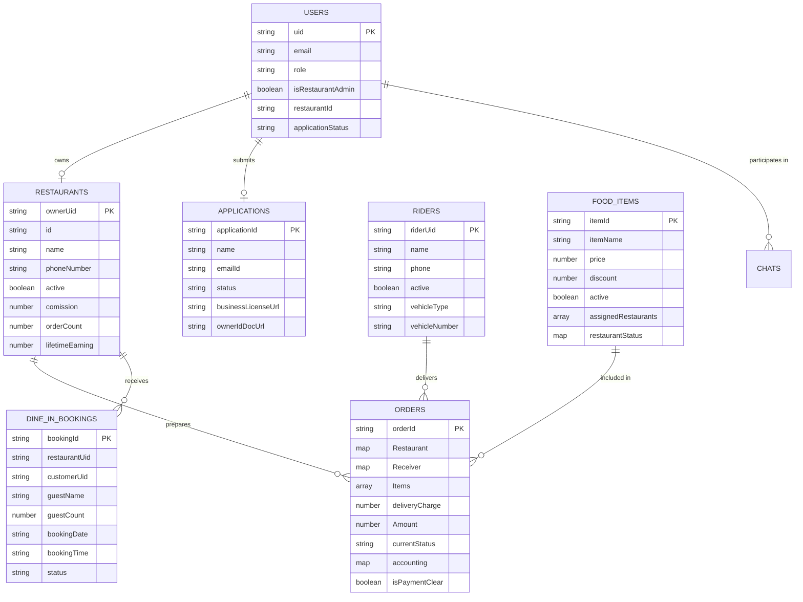

# Database Architecture & Data Dictionary — Thaiseva Food Portal

## 1. Database Architecture & Technology Overview

The **Thaiseva Food Portal** utilizes **Cloud Firestore** as its primary document-oriented NoSQL database. 

### Core Database Architecture Principles
* **Engine**: Cloud Firestore (Native Mode, deployed in multi-region or regional location aligned with `asia-southeast1`).
* **Data Model**: Collection-Document-Subcollection hierarchy.
* **Security & Isolation**: Firestore Security Rules (`firestore.rules`) enforce role-based access control (RBAC) and tenant isolation (`request.auth.uid == resource.data.ownerId`).
* **Integrity Enforcement**: Financial fields (`Amount`, `comission`, `accounting`, `lifetimeEarning`) cannot be written directly by client SDKs; all mutations are executed via Cloud Functions using `firebase-admin` atomic transactions.

---

## 2. Entity Relationship Diagram (Mermaid ERD)



---

## 3. Data Dictionary & Collection Schemas

### 3.1 `users/{uid}`
Stores identity mapping and user role flags.

| Field Name | Type | Nullable | Key | Description |
| :--- | :--- | :--- | :--- | :--- |
| `uid` | String | No | PK | Firebase Auth User Unique ID |
| `email` | String | No | - | Registered user email address |
| `role` | String | No | - | User role (`"MasterAdmin"`, `"restaurantOwner"`, `"customer"`) |
| `serviceCategory` | String | Yes | - | Primary category (`"Restaurant"`) |
| `isRestaurantAdmin` | Boolean | No | - | Flag indicating active verified restaurant owner |
| `restaurantId` | String | Yes | FK | Public restaurant identifier (e.g. `"e4f8"`) |
| `restaurantOwnerUid` | String | Yes | FK | Matches owner `uid` |
| `applicationStatus` | String | Yes | - | Status of partner application (`"Pending"`, `"Verified"`, `"Rejected"`) |
| `createdAt` | Timestamp | No | - | Document creation timestamp |

---

### 3.2 `restaurants/{ownerUid}`
Stores verified restaurant profiles and financial ledger counters.

| Field Name | Type | Nullable | Key | Description |
| :--- | :--- | :--- | :--- | :--- |
| `ownerUid` | String | No | PK | Restaurant owner user UID |
| `id` | String | No | - | Public hex ID (e.g. `"e4f8"`) |
| `name` | String | No | - | Public display name of restaurant (max 120 chars) |
| `phoneNumber` | String | No | - | Contact phone number |
| `emailId` | String | No | - | Official contact and sign-in email; editable only by Master Admin |
| `foodType` | String | Yes | - | Comma-separated cuisines selected from `settings/cuisines` (max 1000 chars) |
| `location` | String | No | - | Physical street address |
| `description` | String | Yes | - | Store summary text (max 2000 chars) |
| `imageUrl` | String | Yes | - | Storage HTTPS URL for cover image |
| `active` | Boolean | No | - | Open/closed store toggle (`true` = open) |
| `comission` | Number | No | - | Commission rate percentage (`0` to `100`) |
| `status` | String | No | - | Onboarding status (`"Verified"`) |
| `orderCount` | Number | No | - | Lifetime delivered order count |
| `lifetimeEarning` | Number | No | - | Lifetime net partner revenue (THB ฿) |
| `updatedAt` | Timestamp | No | - | Last profile modification timestamp |

---

### 3.3 `restaurantApplications/{applicationId}`
Stores pending and processed restaurant partner onboarding applications.

| Field Name | Type | Nullable | Key | Description |
| :--- | :--- | :--- | :--- | :--- |
| `applicationId` | String | No | PK | 12-byte unique hex application ID |
| `name` | String | No | - | Applicant business name |
| `emailId` | String | No | - | Applicant contact email |
| `phoneNumber` | String | No | - | Applicant contact phone |
| `foodType` | String | Yes | - | Proposed comma-separated cuisine selections (max 1000 chars) |
| `location` | String | No | - | Store physical address |
| `status` | String | No | - | Status (`"Draft"`, `"Pending"`, `"Verified"`, `"Rejected"`) |
| `businessLicensePath` | String | Yes | - | Cloud Storage path for business license PDF/Image |
| `ownerIdDocPath` | String | Yes | - | Cloud Storage path for owner ID document |
| `submittedAt` | Timestamp | Yes | - | Application submission timestamp |

---

### 3.4 `food_items/thaiseva-platform/items/{itemId}`
Single Centralized Master Menu Catalog collection. All dishes across all stores exist here.

| Field Name | Type | Nullable | Key | Description |
| :--- | :--- | :--- | :--- | :--- |
| `itemId` | String | No | PK | Unique dish identifier (e.g. `"#ITEM-99120"`) |
| `itemName` | String | No | - | Dish title |
| `price` | Number | No | - | Base unit price in Thai Baht (THB ฿) |
| `discount` | Number | No | - | Percentage discount (`0` to `100`) |
| `category` | String | No | - | Dish category (e.g., `"Noodles"`, `"Beverages"`) |
| `cuisine` | String | Yes | - | Comma-separated cuisines selected from `settings/cuisines` (max 1000 chars) |
| `itemType` | String | No | - | Dietary classification (`"Veg"`, `"Non-Veg"`, `"Vegan"`) |
| `imageUrl` | String | Yes | - | Dish photo HTTPS URL |
| `active` | Boolean | No | - | Global master active toggle |
| `assignedRestaurants` | Array<String> | No | - | Array of authorized restaurant owner UIDs |
| `restaurantStatus` | Map | No | - | Store availability overrides `{ [ownerUid]: { active: boolean } }` |
| `count` | Number | No | - | Total lifetime units sold across network |
| `earning` | Number | No | - | Total lifetime revenue generated by dish (THB ฿) |

---

### 3.5 `orders/{orderId}`
Transactional store for food orders and verified accounting ledger entries.

| Field Name | Type | Nullable | Key | Description |
| :--- | :--- | :--- | :--- | :--- |
| `orderId` | String | No | PK | Unique order ID string |
| `Restaurant` | Map | No | - | Store snapshot `{ ownerId, id, name }` |
| `Receiver` | Map | No | - | Customer snapshot `{ id, name, phoneNumber, address, location }` |
| `Items` | Array<Map> | No | - | Array of dish items `[{ ItemId, ItemName, Quantity, price, discount }]` |
| `deliveryCharge` | Number | No | - | Delivery fee (THB ฿) |
| `Amount` | Number | No | - | Total verified order value (THB ฿) |
| `currentStatus` | String | No | - | State machine status (`"New Order"`, `"Order Confirm"`, `"Preparing"`, `"Ready for pickup"`, `"Out for Delivery"`, `"Delivered"`, `"Cancelled"`) |
| `comission` | Number | No | - | Commission rate percentage stamped at order creation |
| `assignedRiderId` | String | Yes | FK | Assigned courier UID |
| `DeliveryPartner` | Map | Yes | - | Courier snapshot `{ id, name, phone, photo }` |
| `isPaymentClear` | Boolean | No | - | Financial settlement flag (`true` = cleared) |
| `accounting` | Map | Yes | - | Stamped verified earnings `{ amount, commissionPct, adminShare, partnerShare }` |
| `orderDate` | String | No | - | Date string (`"YYYY-MM-DD"`) for query indexing |
| `createdAt` | Timestamp | No | - | Creation timestamp |

---

### 3.6 `riders/{riderUid}`
Directory of food delivery couriers.

| Field Name | Type | Nullable | Key | Description |
| :--- | :--- | :--- | :--- | :--- |
| `riderUid` | String | No | PK | Courier unique UID |
| `name` | String | No | - | Full name of courier |
| `phone` | String | No | - | Contact phone number |
| `active` | Boolean | No | - | Courier active availability toggle |
| `vehicleType` | String | No | - | Vehicle type (`"Motorcycle"`, `"Bicycle"`, `"Car"`) |
| `vehicleNumber` | String | No | - | License plate / vehicle number |
| `createdAt` | Timestamp | No | - | Registration timestamp |

---

## 4. Production Composite Indexes (`firestore.indexes.json`)

To enable high-performance querying without table scans, the database relies on predefined composite indexes:

```json
{
  "indexes": [
    {
      "collectionGroup": "orders",
      "queryScope": "COLLECTION",
      "fields": [
        { "fieldPath": "Restaurant.ownerId", "order": "ASCENDING" },
        { "fieldPath": "orderDate", "order": "DESCENDING" }
      ]
    },
    {
      "collectionGroup": "orders",
      "queryScope": "COLLECTION",
      "fields": [
        { "fieldPath": "Restaurant.ownerId", "order": "ASCENDING" },
        { "fieldPath": "currentStatus", "order": "ASCENDING" }
      ]
    }
  ]
}
```

---

## 5. Documentation Source References

* Database Security Rules: [firestore.rules](file:///d:/projects/food-portal-Rishav/firestore.rules)
* Composite Index Definitions: [firestore.indexes.json](file:///d:/projects/food-portal-Rishav/firestore.indexes.json)
* Database Test Suite: [tests/firestoreRulesIsolation.test.cjs](file:///d:/projects/food-portal-Rishav/tests/firestoreRulesIsolation.test.cjs)


---
*Documentation created by Omnifex Agency*
