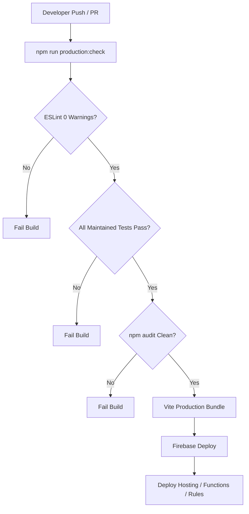

# Cloud Infrastructure, Environment & Deployment Documentation - Thaiseva Food Portal

## 1. Cloud Infrastructure & Hosting Platform

The **Thaiseva Food Portal** infrastructure is hosted on **Google Cloud Platform (GCP) / Firebase Platform**:

| Infrastructure Component | GCP / Firebase Service | Resource Details | Region |
| :--- | :--- | :--- | :--- |
| **Frontend Web Hosting** | Firebase Hosting | Global CDN, HTTP/2, SSL / TLS, Custom Headers | Global |
| **Serverless Compute** | Firebase Cloud Functions v2 | Node.js 22 runtime, maxInstances: 20 | `asia-southeast1` |
| **Database** | Cloud Firestore | Native NoSQL document store | Default Instance |
| **Object Storage** | Firebase Cloud Storage | Private & public GCS buckets | Default Bucket |
| **Authentication** | Firebase Auth | Email/Password, Custom Token Claims | Global |
| **Security Edge** | Firebase App Check | reCAPTCHA Enterprise | Global |

---

## 2. Environment Variables Specification

The system uses separate environment configurations for development (`.env.local`) and production (`.env.production.local`).

> [!CAUTION]
> Sensitive keys, database credentials, and service account tokens must **NEVER** be committed to version control.

| Environment Variable | Required | Scope | Purpose | Example / Placeholder Format |
| :--- | :--- | :--- | :--- | :--- |
| `VITE_FIREBASE_API_KEY` | Yes | Client | Firebase Web SDK Authentication Key | `AIzaSyD-YOUR_API_KEY_HERE` |
| `VITE_FIREBASE_AUTH_DOMAIN` | Yes | Client | Firebase Auth Domain | `thaiseva-food.firebaseapp.com` |
| `VITE_FIREBASE_PROJECT_ID` | Yes | Client | GCP Project ID | `thaiseva-food-portal` |
| `VITE_FIREBASE_STORAGE_BUCKET` | Yes | Client | Storage Bucket URL | `thaiseva-food-portal.appspot.com` |
| `VITE_FIREBASE_MESSAGING_SENDER_ID` | Yes | Client | Cloud Messaging Sender ID | `123456789012` |
| `VITE_FIREBASE_APP_ID` | Yes | Client | Firebase Web App Identifier | `1:123456789012:web:abcdef123` |
| `VITE_FIREBASE_APPCHECK_SITE_KEY` | Yes | Client | reCAPTCHA Enterprise Site Key | `6Ld_YOUR_RECAPTCHA_SITE_KEY` |
| `FUNCTIONS_EMULATOR` | No | Backend | Disables App Check during local emulator testing | `true` / `false` |
| `ENFORCE_APP_CHECK` | No | Backend | Explicit toggle for backend App Check enforcement | `true` / `false` |

---

## 3. Deployment Configuration Files

### 3.1 `firebase.json`
Defines hosting rewrites, HTTP headers, pre-deploy hooks, and function deployment settings:

```json
{
  "hosting": {
    "public": "dist",
    "ignore": ["firebase.json", "**/.*", "**/node_modules/**"],
    "rewrites": [
      {
        "source": "**",
        "destination": "/index.html"
      }
    ],
    "headers": [
      {
        "source": "**",
        "headers": [
          { "key": "X-Content-Type-Options", "value": "nosniff" },
          { "key": "X-Frame-Options", "value": "DENY" },
          { "key": "X-XSS-Protection", "value": "1; mode=block" }
        ]
      }
    ]
  },
  "functions": [
    {
      "source": "functions",
      "codebase": "default",
      "ignore": ["node_modules", ".git", "firebase-debug.log"]
    }
  ],
  "firestore": {
    "rules": "firestore.rules",
    "indexes": "firestore.indexes.json"
  },
  "storage": {
    "rules": "storage.rules"
  }
}
```

---

## 4. Pre-Deployment Verification Protocol (`production:check`)

The repository includes a automated production check script specified in `package.json`:

$$\texttt{npm run production:check}$$

This command executes four strict validation gates:
1. **`npm run verify:production`**: Verifies that environment variables and index files are valid.
2. **`npm run check`**:
   - Runs `eslint src --ext js,jsx --max-warnings 0` (Fails on any warning).
   - Runs the maintained Node.js test list from the `test` script in `package.json`.
   - Runs `vite build` (Compiles React application to `/dist`).
3. **`npm --prefix functions run check`**: Validates syntax of backend modules (`node --check src/index.js`).
4. **`npm audit --omit=dev` & Functions Audit**: Ensures 0 production dependencies have known vulnerabilities.

---

## 5. CI/CD Deployment Pipeline



### Manual CLI Deployment Commands

```bash
# 1. Execute Production Check Pipeline
npm run production:check

# 2. Deploy Cloud Functions Only
cd functions && firebase deploy --only functions:food-portal

# 3. Deploy Frontend Hosting Only
firebase deploy --only hosting

# 4. Deploy Firestore Rules & Indexes
firebase deploy --only firestore

# 5. Full Production Deployment
firebase deploy
```

---

## 6. Rollback & Emergency Protocol

If a production deployment exhibits unexpected behavior:
1. **Hosting Rollback**: Navigate to Firebase Console -> Hosting -> Release History, and click "Rollback" to reactivate the previous build snapshot immediately.
2. **Cloud Functions Rollback**: Deploy previous git commit:
   ```bash
   git checkout <PREVIOUS_STABLE_TAG_OR_COMMIT>
   npm run production:check
   firebase deploy --only functions
   ```

---

## 7. Shared Firebase Project Guardrails

The `gothai-ffea1` project also serves non-food products. A food-portal deployment must not replace shared rules or indexes with a food-only subset.

Before deploying:

1. Run `node scripts/merge-live-rules.mjs` when a rules change is required, and review the resulting diff.
2. Keep the shared `isAdmin()` helper and all hotel, travel, vehicle, booking, chat, and website rules unchanged unless their owners approve the same change.
3. Treat `firestore.indexes.json` as a complete production manifest. Index deployment can delete live indexes omitted from the file.
4. Run `npm run production:check`; it includes the Firestore rules and index isolation tests.
5. Deploy rules first when a backend release depends on new access, then Functions, then Hosting. Deploy indexes separately and wait for them to finish building before enabling dependent queries.
6. Smoke-test Master Admin access, one verified restaurant tenant, customer checkout, and at least one shared non-food flow after a rules or index deployment.

Prefer privileged writes through Cloud Functions instead of widening direct client-write rules.

---

## 8. Documentation Source References

* Pre-flight Check Script: [`scripts/verify-production.mjs`](../scripts/verify-production.mjs)
* Security policy: [SECURITY.md](SECURITY.md)
* Firebase Config: [`firebase.json`](../firebase.json)
* Package Build Pipelines: [`package.json`](../package.json)


---
*Documentation created by Omnifex Agency*
